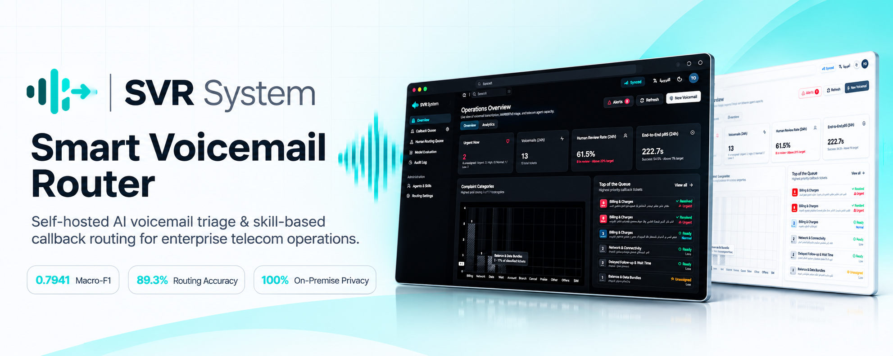
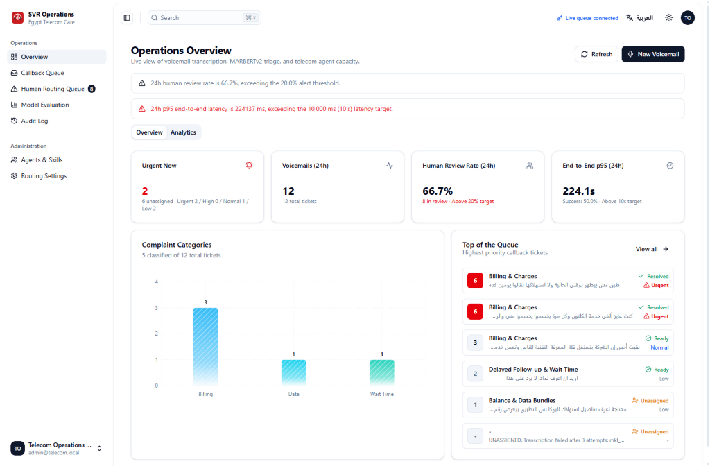
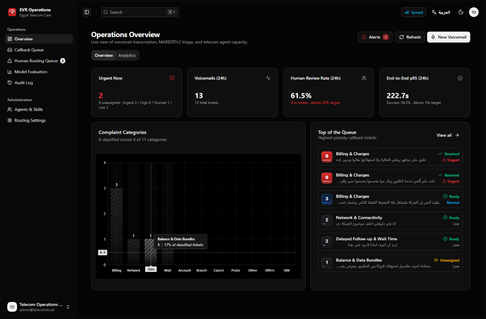
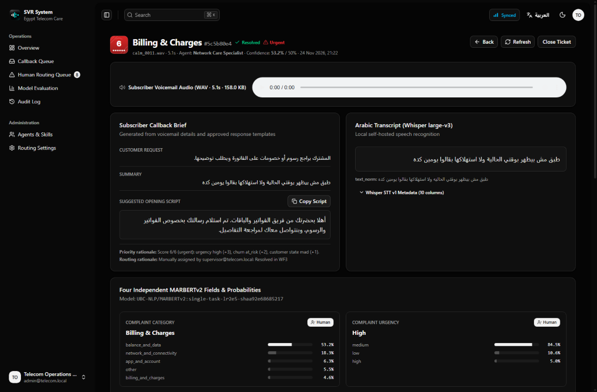
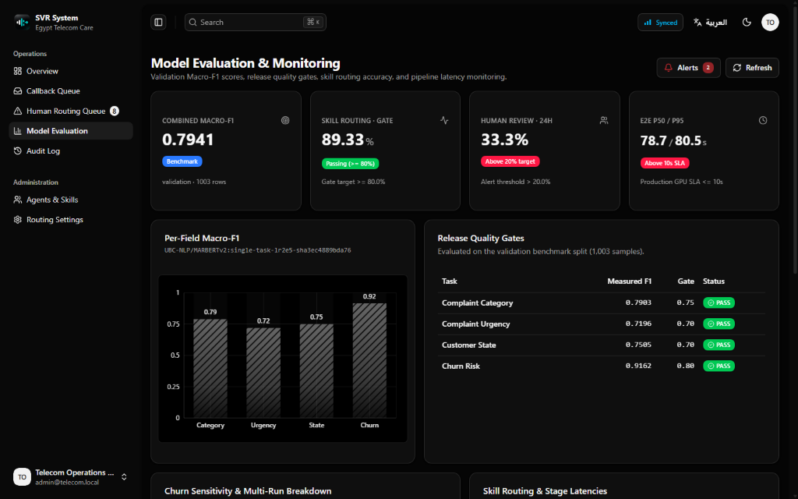

<div align="center">

<picture>
  <source media="(prefers-color-scheme: light)" srcset="assets/svr-banner-light.png">
  <source media="(prefers-color-scheme: dark)" srcset="assets/svr-banner-dark.png">
  
</picture>

<br/>

[](#quick-start)
[](docs/ARCHITECTURE-AND-DEPLOYMENT.md)
[](docs/MODEL-CARD.md)
[](docs/DPIA.md)
[](https://svr-data-annotation.vercel.app)

<br/>


<p align="center">
  <strong>Smart Voicemail Router (SVR)</strong> is a self-hosted, enterprise AI voicemail triage and callback operations platform built for telecom customer care.<br/>
  It converts raw Egyptian Arabic and code-switched subscriber voicemails into <strong>prioritized, skill-routed, explainable callback tickets</strong> in seconds, with zero third-party audio egress.
</p>

<picture>
  <source media="(prefers-color-scheme: light)" srcset="assets/screenshots/overview-light.png">
  <source media="(prefers-color-scheme: dark)" srcset="assets/screenshots/overview-dark.png">
  
</picture>

</div>

---

## Table of Contents

- [Why Smart Voicemail Router](#why-smart-voicemail-router)
- [Core Product Capabilities](#core-product-capabilities)
- [End-to-End 6-Stage AI Pipeline](#end-to-end-6-stage-ai-pipeline)
- [Product Tour](#product-tour)
- [Validated Model Performance](#validated-model-performance)
- [Quick Start](#quick-start)
- [Security, Privacy & Governance](#security-privacy--governance)
- [REST API & WebSocket Reference](#rest-api--websocket-reference)
- [Repository Architecture](#repository-architecture)
- [Documentation Hub](#documentation-hub)
- [Engineering Team](#engineering-team)

---

## Why Smart Voicemail Router

Telecom contact centers accumulate thousands of subscriber voicemails across peak shifts and network incidents. When voicemails sit in uninspected chronological queues, **service-outage escalations and high-churn subscribers wait behind routine inquiries**, while callback specialists spend valuable handle time listening to raw audio from scratch.

**Smart Voicemail Router (SVR)** replaces FIFO voicemail backlogs with an end-to-end operational control plane:

1. **Ingests & Encrypts Locally**: Accepts uploaded audio (`WAV`, `MP3`, `M4A`) or live in-browser 16 kHz microphone recordings, validates container headers and duration (`<= 60s`), deduplicates via `SHA-256`, encrypts audio at rest with **Fernet (`AES-128-CBC + HMAC-SHA256`)**, and returns `HTTP 202 Accepted` in under 2 seconds.
2. **Transcribes Dialectal Telecom Speech**: Applies DC-offset removal, 80 Hz high-pass filtering, RMS/peak loudness normalization, and offline Silero VAD chunking, running **`CohereLabs/cohere-transcribe-arabic-07-2026`** (`NAMAA-Space/cohere-transcribe-arabic-07-2026-int8` on 6 GB GPUs) with `faster-whisper` (`Whisper large-v3`, `beam_size=3`) CPU fallback on Egyptian Arabic speech mixed with English telecom terms (`eSIM`, `4G`, `5G`, `DSL`, `Wi-Fi`, `MB/GB`).
3. **Audits & Repairs via VoiceGate Orchestrator (LangGraph)**: Runs a local-first **LangGraph** `StateGraph` agent (`AgenticTranscriptGate` backed by `qwen2.5:3b` via loopback Ollama) in an iterative audit-and-fix loop anchored in Egyptian telecom context, with anti-hallucination guardrails, acoustic-degradation escalation (`uncertain_transcript`), and max-1 adaptive re-audit when MARBERTv2 category confidence falls below `0.60`.
4. **Classifies Across Four Independent Heads**: Evaluates verified, normalized transcripts (`text_norm`) through four dedicated single-task **`UBC-NLP/MARBERTv2`** models for **Complaint Category**, **Complaint Urgency**, **Customer State**, and **Churn Risk** with calibrated probability distributions and confidence gating.
5. **Scores Priority & Routes by Skill + Capacity**: Applies a transparent, deterministic 1-to-6 priority rule and assigns each ticket to an available, on-shift specialist matching the required telecom skill (`Network`, `Billing`, `General`), or escalates low-confidence cases to the **Human Routing Queue**.
6. **Equips Agents Before They Dial**: Generates a concise bilingual callback brief from the final verified transcript and an approved Arabic/English opening script grounded strictly in verified ticket facts, streamed live to operators over WebSockets.

---

## Core Product Capabilities

<table>
  <tr>
    <td width="50%" valign="top">
      <h3>&nbsp; Dialectal Arabic + Telecom STT</h3>
      <p>Self-hosted <code>CohereLabs/cohere-transcribe-arabic-07-2026</code> (INT8 GPU) and <code>Whisper large-v3</code> fallback pipeline with offline Silero VAD, 16 kHz mono PCM normalization, language-mix detection, and a locked 10-column structured STT schema engineered for Egyptian Arabic customer care.</p>
    </td>
    <td width="50%" valign="top">
      <h3>&nbsp; 4-Head MARBERTv2 Triage</h3>
      <p>Four independent fine-tuned <code>UBC-NLP/MARBERTv2</code> classifiers achieving <strong>0.7941 combined Macro-F1</strong> across 11 telecom complaint categories, urgency, emotional state, and churn risk.</p>
    </td>
  </tr>
  <tr>
    <td width="50%" valign="top">
      <h3>&nbsp; Deterministic Priority & Skill Routing</h3>
      <p>Zero-black-box priority scoring (<code>1..6</code> -> <code>Urgent</code>, <code>High</code>, <code>Normal</code>, <code>Low</code>) paired with real-time specialist shift availability, workload capacity caps, and instant manual routing override controls.</p>
    </td>
    <td width="50%" valign="top">
      <h3>&nbsp; Native Bilingual Console (EN / AR RTL)</h3>
      <p>Built on <strong>React 19, Vite, Tailwind CSS v4, and shadcn/ui</strong> with instant English/Arabic RTL switching, <code>Ctrl+K</code> command menu, Crisp Light (Primary) and Pure Black Dark themes, and live WebSocket synchronization.</p>
    </td>
  </tr>
  <tr>
    <td width="50%" valign="top">
      <h3>&nbsp; Human-in-the-Loop Governance</h3>
      <p>Supervisors preview priority and routing impacts before applying label corrections. Every human override preserves original model provenance (<code>model</code> vs <code>human</code>) and writes an immutable JSON diff to the Audit Log.</p>
    </td>
    <td width="50%" valign="top">
      <h3>&nbsp; Sovereign Security & Observability</h3>
      <p>Fernet audio encryption at rest, <code>HttpOnly</code> session cookies + double-submit CSRF tokens, strict 3-tier RBAC scoping, sliding-window rate limiting, and pre-provisioned Prometheus + Grafana dashboards.</p>
    </td>
  </tr>
</table>

---

## End-to-End 6-Stage AI Pipeline

```mermaid
flowchart LR
    S1["01. Audio Intake & Vault<br/>WAV/MP3/M4A + 16 kHz Mic<br/>ffprobe <= 60s · Fernet AES-128"]
    S2["02. Cohere Arabic ASR / Whisper<br/>Silero VAD + 30s Chunking<br/>Egyptian Arabic + EN Telecom"]
    S3["03. VoiceGate Agent (LangGraph)<br/>Qwen2.5-3B Audit-and-Repair Loop<br/>Guardrails + Adaptive Re-Audit"]
    S4["04. 4x MARBERTv2 Triage<br/>Category · Urgency · State · Churn<br/>Calibrated Confidence Gate"]
    S5["05. Priority & Skill Route<br/>Deterministic Score 1..6<br/>Network / Billing / General"]
    S6["06. Live Operator Console<br/>Grounded AR/EN Script Brief<br/>WebSocket Push + Audit Log"]
    HR["Human Routing Queue<br/>Uncertain Transcript / Low Conf /<br/>Manual Override Review"]

    S1 -->|"HTTP 202 (< 2s)"| S2
    S2 -->|"10-Col STT v1"| S3
    S3 -->|"Verified / Repaired"| S4
    S3 -->|"Uncertain / Acoustic Loss"| HR
    S4 -->|"High Confidence"| S5
    S4 -->|"Below Threshold"| HR
    S5 -->|"Agent Assigned"| S6
    S5 -->|"No Capacity / Paused"| HR
    HR -->|"Supervisor Override"| S6
```



<br/>

| Stage | Engine / Mechanism | Key Output & Guardrail |
| :--- | :--- | :--- |
| **01. Audio Intake** | Magic-byte probe + `ffprobe` + Fernet vault | Enforces `<= 25 MB` & `<= 60s`, normalizes to 16 kHz mono WAV, deduplicates by `SHA-256` & `Idempotency-Key`, returns `202 Accepted` |
| **02. Transcription** | `normalize_wav_16k_loudness` + offline Silero VAD + `CohereArabicSTTService` (INT8/BF16) or `faster-whisper` fallback | Removes DC/80 Hz rumble, boosts quiet recordings, splits `>30s` clips on VAD pauses, produces Arabic + EN transcript, `text_norm`, logprobs, and `language_mix` |
| **03. VoiceGate Audit** | **LangGraph** `StateGraph` (`AgenticTranscriptGate` + local Ollama `qwen2.5:3b`) | Runs `pre_repair -> audit -> confidence_check -> finalize` loop, removes Whisper stutters, repairs Egyptian telecom ASR errors, enforces anti-hallucination & acoustic caps (`min_avg_logprob < -0.75`) |
| **04. Classification** | `4x Single-Task UBC-NLP/MARBERTv2` | Consumes verified `text_norm`, outputs validated class labels, per-class probability vectors summing to `1.0`, and minimum-head confidence gating |
| **05. Priority & Routing** | Deterministic scoring + Telecom Skill Matrix | Computes priority score `1..6`, maps 11 categories to `Network` / `Billing` / `General`, checks live agent capacity, or flags Human Review |
| **06. Callback Brief & Ops** | Versioned bilingual templates + `/ws/queue` | Builds grounded `summary` (from repaired transcript), `customer_request`, and `suggested_script`; broadcasts live ticket updates to connected operators |

> [!IMPORTANT]
> **Transparent Priority Formula (Score `1` to `6`)**
> Priority is computed deterministically from validated classification heads so supervisors can audit every queue placement:
> - **Urgency**: `high = 3`, `medium = 2`, `low = 1`
> - **Churn Risk**: `at_risk = +2`, `not_at_risk = +0`
> - **Customer State**: `mad` or `frustrated = +1`, `calm` or `satisfied = +0`
> - **Queue Buckets**: `5..6 -> Urgent` | `4 -> High` | `3 -> Normal` | `1..2 -> Low` (any missing/unclear head routes directly to the **Human Routing Queue**).

---

## Product Tour

<table>
  <tr>
    <td width="50%" valign="top">
      
      <p align="center"><strong>Operations Overview (Crisp Light Mode - Primary)</strong><br/><sub>High-contrast daylight workspace with instant theme, language (EN/AR RTL), and Ctrl+K command switching.</sub></p>
    </td>
    <td width="50%" valign="top">
      
      <p align="center"><strong>Operations Overview (Black Dark Mode - Secondary)</strong><br/><sub>Real-time KPI telemetry, patterned fade-out category volume chart, and top-priority callback queue.</sub></p>
    </td>
  </tr>
  <tr>
    <td width="50%" valign="top">
      
      <p align="center"><strong>Ticket Evidence & Supervisor Override</strong><br/><sub>Encrypted audio streaming, grounded bilingual script brief, 4-head MARBERTv2 probabilities, and audit timeline.</sub></p>
    </td>
    <td width="50%" valign="top">
      
      <p align="center"><strong>Model Evaluation & Release Quality Gates</strong><br/><sub>Per-field validation Macro-F1, 6/6 automated release gates, skill routing accuracy, and stage p50/p95 latencies.</sub></p>
    </td>
  </tr>
</table>

---

## Validated Model Performance

SVR models were trained and selected on the curated **SVR Voicemail Corpus** (`6,522` recordings, `12.6` hours of 16 kHz mono audio; `5,096` quality-filtered samples stratified into `3,575` train / `1,003` validation / `518` held-out test, seed `42`). All benchmarks below are measured on the **1,003-sample validation split** across a 5-seed protocol (`42, 1337, 2023, 7, 99`):

| Task / Metric | Classes / Scope | TF-IDF Baseline | SVR MARBERTv2 | Release Gate | Status |
| :--- | :--- | :---: | :---: | :---: | :---: |
| **Complaint Category** | 11 telecom classes | `0.7261` | **`0.7903`** | `>= 0.75` | **PASS** |
| **Complaint Urgency** | `high`, `medium`, `low` | `0.6789` | **`0.7196`** | `>= 0.70` | **PASS** |
| **Customer State** | `calm`, `frustrated`, `mad`, `satisfied` | `0.5561` | **`0.7505`** | `>= 0.70` | **PASS** |
| **Churn Risk** | `at_risk`, `not_at_risk` | `0.8840` | **`0.9162`** | `>= 0.80` | **PASS** |
| **Combined Macro-F1** | Mean across all 4 heads | `0.7113` | **`0.7941`** | `>= 0.75` | **PASS** |
| **Skill Routing Agreement** | `Network` / `Billing` / `General` | - | **`89.33%`** | `>= 80.0%` | **PASS** |

Full training hyperparameters, confusion matrices, per-seed variance, and calibration notes are documented in the [Model Card](docs/MODEL-CARD.md) and [Model Selection Report](research/svr-model-selection-report.md).

---

## Quick Start

> [!TIP]
> **Deploying on a new machine with an AI agent?** Point your agent to [AGENTS.md](AGENTS.md) right after `git clone`. It detects GPU/RAM/Docker, prepares `seed_99` ONNX INT8 & Egyptian Whisper CT2 models, launches the matching Compose profile, and verifies `/api/health`.

### Option A: One-Command Production Stack (Docker Compose)

Launches **PostgreSQL 16**, **Redis 7**, **Ollama (`qwen2.5:3b` or `aya-expanse:8b`)**, **FastAPI Backend**, **Scalable AI Worker**, **Vite/Nginx Operator Console**, **Caddy Auto-HTTPS**, **Prometheus**, and **Grafana**:

```bash
# 1. Clone the repository
git clone -b hazem/svr-production-build https://github.com/hazemelerefey/smart-voicemail-router.git
cd smart-voicemail-router

# 2. Download seed_99 MARBERTv2 from Google Drive & export ONNX INT8
pip install gdown onnx onnxscript onnxruntime
python3 ops/download_models.py

# 3. Bootstrap secrets, build containers, pull Ollama model, and verify /api/health:
#    - CPU / Oracle Cloud ARM (16-24 GB RAM):
bash ops/deploy_server.sh

#    - RTX 3050 (6 GB VRAM) + 16 GB RAM (Cohere Arabic INT8 + qwen2.5:3b):
pip install torch transformers accelerate bitsandbytes silero-vad
python3 ops/download_models.py --with-cohere-int8
bash ops/deploy_server.sh --gpu-6gb
```

| Service | Default URL | Purpose |
| :--- | :--- | :--- |
| **Operator Console** | `http://localhost:3000` | Bilingual React 19 + shadcn/ui web application |
| **REST API & OpenAPI** | `http://localhost:8000/docs` | Interactive OpenAPI 3.1 documentation & health probe (`/api/health`) |
| **Prometheus** | `http://localhost:9090` | 15s metrics scraping & pipeline alert rules |
| **Grafana** | `http://localhost:3001` | Pre-provisioned SVR Operations & Latency dashboard |

### Option B: Standalone Local Development (Zero External Containers)

SVR automatically falls back to **SQLite WAL** and an **in-process async worker** when PostgreSQL and Redis are not configured:

```bash
# 1. Backend API (Python 3.11+ and ffmpeg on PATH)
python -m venv .venv
# Windows PowerShell: .\.venv\Scripts\Activate.ps1 | Linux/macOS: source .venv/bin/activate
pip install -r backend/requirements.txt
pip install --no-deps -e backend
uvicorn svr_platform.api.main:app --host 127.0.0.1 --port 8000 --reload
```

```bash
# 2. Frontend Console (Node.js 22+)
cd frontend
npm ci
npm run dev
```

Open `http://localhost:3000` and sign in with a seeded bootstrap operator account (default dev password configured via `SVR_BOOTSTRAP_PASSWORD` in `.env.example`):

| Role | Seeded Email | Access Scope |
| :--- | :--- | :--- |
| **Admin** | `admin@telecom.local` | Full platform: Overview, Queue, Review Queue, Evaluation, Audit Log, Agents & Skills, Routing Settings |
| **Supervisor** | `supervisor@telecom.local` | Operations Overview, Queue, Review Queue, Label Overrides, Reassignment, Automatic Routing Control, Audit Log |
| **Network Agent** | `network.agent@telecom.local` | Scoped strictly to own assigned `My Callbacks` tickets and audio |
| **Billing Agent** | `billing.agent@telecom.local` | Scoped strictly to own assigned `My Callbacks` tickets and audio |
| **General Agent** | `general.agent@telecom.local` | Scoped strictly to own assigned `My Callbacks` tickets and audio |

---

## Security, Privacy & Governance

- **Encryption at Rest**: Raw voicemail files are encrypted before disk persistence using **Fernet (`AES-128-CBC + HMAC-SHA256`)** and decrypted strictly in memory for authenticated playback or worker inference.
- **Session & CSRF Hardening**: Passwords use `bcrypt` (cost `12`); sessions use server-revocable `SHA-256` token hashes stored in `HttpOnly`, `SameSite=Lax` cookies paired with double-submit `X-CSRF-Token` verification on all state-mutating requests.
- **Zero Web-Storage Secrets**: No session tokens, JWTs, or CSRF secrets are ever written to `localStorage` or `sessionStorage`, enforced automatically in CI.
- **Strict RBAC & IDOR Prevention**: Agents can never enumerate or stream unassigned tickets or tickets belonging to other specialists (`HTTP 403`).
- **SHA-256 Test-Once Guard**: Held-out test evaluation is cryptographically gated via `backend/svr_platform/evaluation/once_guard.py` to prevent test-split leakage.

---

## REST API & WebSocket Reference

| Endpoint | Method | Roles | Description |
| :--- | :---: | :--- | :--- |
| `/api/auth/login` · `/logout` · `/me` | `POST` / `GET` | Public / Auth | Session authentication, revocation, and operator profile |
| `/api/voicemails` | `POST` | Admin, Supervisor, Agent | Upload audio (`<= 25 MB`, `<= 60s`), encrypt, enqueue async triage (`202`) |
| `/api/voicemails/{id}/audio` | `GET` | Admin, Supervisor, Assigned Agent | Ownership-checked in-memory decryption & audio stream |
| `/api/tickets` · `/api/tickets/{id}` | `GET` / `PATCH` | Admin, Supervisor, Agent | Priority-sorted queue, filters, status lifecycle, and reassignment |
| `/api/tickets/{id}/preview-correction` | `POST` | Admin, Supervisor | Non-mutating preview of recomputed priority, script, and agent route |
| `/api/tickets/{id}/correct` | `POST` | Admin, Supervisor | Apply human label override, record provenance, and append audit diff |
| `/api/agents` · `/api/settings/*` | `GET` / `PUT` / `PATCH` | Admin, Supervisor | Specialist roster, 11-category skill matrix, thresholds, and script templates |
| `/api/evaluation/runs` · `/api/monitoring/summary` | `GET` | Admin, Supervisor | Validation Macro-F1 runs, confidence histogram, 24h review rate, p50/p95 latencies |
| `/api/audit-logs` · `/api/audit-logs/export` | `GET` | Admin, Supervisor | Paginated audit trail and formula-safe CSV / JSON compliance export |
| `/ws/queue` | `WS` | Authenticated | Organization- and role-scoped real-time ticket & pipeline stage stream |

---

## Repository Architecture

```text
smart-voicemail-router/
├── AGENTS.md                   # Autonomous AI agent onboarding & hardware-profile deployment guide
├── assets/                     # Adaptive product banners & live UI screenshots
├── backend/                    # FastAPI application, SQLAlchemy 2.0 ORM & AI pipeline
│   ├── svr_platform/
│   │   ├── api/                # REST endpoints, RBAC, rate limiting & WebSocket QueueHub
│   │   ├── evaluation/         # Production evaluation CLI & SHA-256 test-once guard
│   │   └── services/           # Intake, Fernet crypto, Whisper STT, LangGraph VoiceGate, 4x MARBERTv2 (ONNX/PyTorch), routing & briefs
│   ├── tests/                  # End-to-end API, security, crypto, routing & evaluation pytest suite
│   └── Dockerfile              # Multi-stage Python 3.11 production container
├── frontend/                   # React 19 + Vite + Tailwind CSS v4 + shadcn/ui console
│   ├── src/
│   │   ├── components/         # AppSidebar, SvrHeader, CommandMenu, Intake Sheet & shadcn/ui
│   │   ├── context/            # Auth/CSRF session, WebSocket live sync, theme & RTL providers
│   │   ├── features/           # Overview, Queue, Ticket Detail, Review, Eval, Audit & Admin views
│   │   ├── lib/                # Typed API client, EN/AR i18n, taxonomy & 16 kHz WAV recorder
│   │   └── routes/             # Type-safe TanStack Router file-based route tree
│   ├── nginx.conf              # Production SPA + /api & /ws reverse proxy with security headers
│   └── Dockerfile              # Multi-stage Node 22 build -> Nginx 1.27 Alpine runtime
├── infra/                      # Standardized evaluation harness, split verifier & metric tests
├── ops/                        # Server bootstrap, Drive downloader, ONNX/CT2 converters, Caddyfile, Prometheus & backups
├── docs/                       # Architecture spec, Model Card, DPIA & verification reports
├── research/                   # Literature synthesis & 5-seed model selection benchmarks
├── docker-compose.yml          # Base production stack (Postgres, Redis, Ollama, Backend, Worker, Frontend, Prometheus, Grafana)
├── docker-compose.prod.yml     # Caddy Auto-HTTPS & warm-RAM production overlay
├── docker-compose.gpu-6gb.yml  # RTX 3050 (6 GB VRAM) sequential GPU overlay (Egyptian Whisper CT2 + aya-expanse:8b)
└── .github/workflows/          # ci.yml (tests, pip-audit, Vite build, static guards) & deploy.yml (multi-arch GHCR + SSH CD)
```

---

## Documentation Hub

| Document | Summary |
| :--- | :--- |
| [**AI Agent Onboarding (AGENTS.md)**](AGENTS.md) | Autonomous clone-to-deploy playbook for new CPU and RTX 3050 (6 GB) machines |
| [**Architecture & Deployment Guide**](docs/ARCHITECTURE-AND-DEPLOYMENT.md) | System topology, 13-table schema, Docker/GPU deployment, scaling workers, backups, and runbooks |
| [**Model Card**](docs/MODEL-CARD.md) | Whisper large-v3 + 4x single-task MARBERTv2 architecture, training protocol, metrics, and limitations |
| [**Data Protection Impact Assessment (DPIA)**](docs/DPIA.md) | Threat model, Fernet encryption lifecycle, retention policy, RBAC controls, and telecom privacy safeguards |
| [**Build Verification Report**](docs/BUILD-VERIFICATION.md) | End-to-end functional, evaluation, security, and UI verification evidence |
| [**Model Selection Research**](research/svr-model-selection-report.md) | 14-paper Arabic speech/NLP literature synthesis and controlled 5-seed benchmark comparison |

---

## Running Tests & Quality Gates

```bash
# Backend & evaluation harness test suite
PYTHONPATH=.:backend pytest backend/tests infra/tests -v

# Frontend TypeScript check, production bundle & vulnerability audit
cd frontend
npx tsc --noEmit
npm run build
npm audit --audit-level=high
```

---

## Engineering Team

| Engineer | Domain Ownership |
| :--- | :--- |
| **Hazem Elerefy** | Training Lead, Dataset Curation, Model Selection & Production Platform Architecture |
| **Sira** | Dialectal Speech & MARBERTv2 Single-Task Text Classification |
| **Aya** | ML Infrastructure, Evaluation Harness & Quality Gate Verification |
| **Ibthal** | Deterministic Priority Formula, Telecom Skill Matrix & Callback Routing |
| **Arafa** | Systems Integration & End-to-End Workflow Validation |

---

<div align="center">
  <sub>Built for high-reliability Arabic telecom customer-care operations · <strong>Smart Voicemail Router</strong></sub>
</div>
