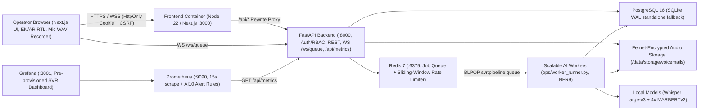

# Smart Voicemail Router (SVR) - Architecture and Deployment Guide

**Document ID:** SVR-ARCH-01  
**PRD Reference:** `docs/project/PRD.md` (`SVR-PRD-02` v1.0, Sections 9, 10, 11, 15, 16)  
**Target Domain:** Telecom customer-care operations (single-speaker Egyptian Arabic subscriber voicemails)  
**Last Updated:** 2026-11-24  
**Owner:** SVR Team  

---

## 1. Production Architecture Overview

SVR is a local-first, single-tenant web platform composed of a Next.js operator UI, a FastAPI REST and WebSocket backend, horizontally scalable Python AI workers, PostgreSQL 16, Redis 7, encrypted audio storage, and a Prometheus + Grafana observability stack.

### 1.1 System Architecture Diagram



### 1.2 Voicemail-to-Ticket Execution Flow (WF1, PRD Section 11.2)

```text
[Browser Upload / 16 kHz Mic WAV]
  -> [POST /api/voicemails: stream <= 25 MB, magic + ffprobe <= 60s, SHA-256/Idempotency dedup]
  -> [Encrypt audio via Fernet -> create Voicemail + Ticket (status=processing) -> HTTP 202 (< 2s)]
  -> [Async Pipeline Worker (Redis queue or in-process background task)]
       1. transcribe : Whisper large-v3 (faster-whisper) -> text, text_norm, 10-col STT v1, language_mix
       2. classify   : 4x Single-task UBC-NLP/MARBERTv2 (lr 2e-5) -> 4 independent labels + probs + confidence
       3. priority   : Fixed rule (urgency 1..3 + churn 0/2 + state 0/1 = score 1..6 -> bucket; null -> Human Review)
       4. route      : FR20 skill mapping (Network/Billing/General), availability, capacity, seed order, kill switch
       5. brief      : summary = transcript[:200], category customer_request, grounded template suggested_script
  -> [Persist Ticket + AIInteractionLog + AuditEvent + Prometheus metrics]
  -> [QueueHub WebSocket push (/ws/queue) -> Live dashboard update without page reload]
```

The API never blocks HTTP requests on ML inference. Uploads return HTTP `202 Accepted` within 2 seconds (FR1), while stage progress and final assignment stream live over `/ws/queue` (FR3, NFR18).

---

## 2. Data Model Overview (PRD Section 11.4)

Defined in `backend/svr_platform/models.py` (SQLAlchemy 2.0 ORM, Alembic-ready, PostgreSQL 16 in production and SQLite WAL for standalone development):

| Table | Purpose | Key Constraints and Indexes |
|---|---|---|
| `organizations` | Single-tenant organization root (`FR24`) | Unique `slug`; referenced by `organization_id` across all operational tables |
| `users` | Operator accounts (`admin`, `supervisor`, `agent`) | Unique `(organization_id, email)`, `password_hash` (bcrypt 12), `token_version`, `linked_agent_id` |
| `user_sessions` | Server-side session tracking (`FR22`, `NFR1`) | Unique `token_hash` (SHA-256), `role_snapshot`, `token_version_snapshot`, `last_activity_at`, `expires_at`, `revoked` |
| `agents` | Callback agents with telecom skills and capacity (`FR19`) | Composite index `(organization_id, seed_order)`, `skills` JSON array, `capacity`, `current_load`, `available`, `active` |
| `voicemails` | Ingested audio metadata and STT v1 payload (`FR1`, `FR4`) | Unique `(organization_id, idempotency_key)` (`NFR13`), `content_sha256` index, `encrypted=True`, `stt_v1_json` (10 columns) |
| `tickets` | Structured callback tickets (`FR6`-`FR15`, `S4`, `FR21`) | Composite indexes `(organization_id, status, priority_score, created_at)`, `(organization_id, assigned_agent_id)`, `(organization_id, needs_human_review)` for 100k+ rows (`NFR8`); stores `label_sources` (`model`/`human`), `probabilities`, `confidence`, `confidence_threshold_snapshot`, `config_snapshot`, `stage_status`, `stage_timing_ms` |
| `assignments` | Active and historical agent ticket assignments | Indexed `(ticket_id, assigned_at)`, `assigned_by`, `route_reason`, `status` (`active`, `released`, `completed`) |
| `audit_events` | Immutable operational audit log (`FR18`, `NFR19`) | Indexed `(organization_id, created_at)` and `(entity_type, entity_id)`; stores `old_value` and `new_value` JSON diffs |
| `ai_interaction_logs` | Per-stage AI execution ledger (`AI2`) | Indexed `(ticket_id, created_at)`; records `stage`, `model` (or `"rules"`), `input_ref` (never raw audio), `output`, `latency_ms` |
| `eval_runs` | Validation and guarded test evaluation records (`AI9`, `AI10`) | Stores `dataset_version`, `split` (`validation` or `test`), `model_version`, `config`, `metrics`, `guard_claim_id` |
| `skill_mappings` | 11-category telecom skill mapping (`FR20`) | Unique `(organization_id, category)` covering all 11 categories (`Network`, `Billing`, `General`) |
| `script_templates` | Bilingual grounded callback script templates (`FR14`, `FR21`) | Unique `(organization_id, category)`; `template_ar`, `template_en`, `customer_request_ar`, `customer_request_en`, `version` |
| `system_settings` | Organization-level runtime knobs (`FR21`, `10.5`) | `confidence_threshold` (`0.5`), `auto_routing_enabled` (kill switch), `retention_days` (`90`), `weekly_sample_rate` (`0.05`) |

---

## 3. REST API and WebSocket Summary (PRD D3, D6, NFR16)

OpenAPI 3.1 documentation is automatically served at `/docs` and `/openapi.json`. All request schemas enforce Pydantic v2 `extra="forbid"` to prevent mass assignment.

| Method & Path | Roles | Security & Rate Limit | Summary |
|---|---|---|---|
| `POST /api/auth/login` | Public | `10/60s` per IP + 5-failure lockout | Bcrypt verify, creates session, sets `HttpOnly svr_session` + `svr_csrf` |
| `POST /api/auth/logout` | Any authenticated | CSRF required | Revokes session, bumps `token_version`, clears cookies |
| `GET /api/auth/me` | Any authenticated | Session required | Returns authenticated user profile and role |
| `POST /api/voicemails` | Admin, Supervisor, Agent | CSRF + `30/60s` per IP | Validates WAV/MP3/M4A (`<= 25 MB`, `<= 60 s`), dedups, encrypts, returns `202` in `< 2 s` |
| `GET /api/voicemails/{id}/audio` | Admin, Supervisor, Assigned Agent | IDOR ownership check | Decrypts in memory and streams authenticated audio |
| `GET /api/tickets` | Admin, Supervisor, Agent | Agent auto-scoped to own tickets | Cursor + offset pagination, urgent-first sort, bucket/category/status/agent/review/Arabic search filters |
| `GET /api/tickets/{id}` | Admin, Supervisor, Assigned Agent | IDOR check (`403` for other agents) | Full ticket detail, 10-col STT v1, probabilities, provenance, brief, AI & audit logs |
| `POST /api/tickets/{id}/preview-correction` | Admin, Supervisor | CSRF required | WF2 Step 4 non-mutating preview of recomputed priority, brief, and agent route |
| `POST /api/tickets/{id}/correct` | Admin, Supervisor | CSRF required | Applies human label edits, sets `label_sources="human"`, recomputes priority/route, logs audit diff |
| `PATCH /api/tickets/{id}` | Admin, Supervisor, Assigned Agent | CSRF + lifecycle transition check | Status transitions, reassignment, capacity release/consume, review flag updates |
| `GET /api/agents` | Admin, Supervisor | Session required | Lists organization agents, skills, capacity, and current load |
| `POST /api/agents` | Admin only | CSRF + Admin RBAC | Creates callback agent with skills, capacity, availability, and seed order |
| `PATCH /api/agents/{id}` | Admin only | CSRF + Admin RBAC | Edits agent attributes or deactivates agent |
| `GET /api/settings` | Admin, Supervisor | Session required | Returns active threshold, kill switch state, retention days, and weekly sample rate |
| `PATCH /api/settings` | Admin (all); Supervisor (kill switch only) | CSRF + RBAC | Updates settings for new tickets only (`FR21`); logs `AuditEvent` |
| `GET /api/settings/skills` | Admin, Supervisor | Session required | Lists current 11-category skill mapping |
| `PUT /api/settings/skills` | Admin only | CSRF + validates all 11 categories | Updates telecom skill mapping (`FR20`) |
| `GET /api/settings/templates` | Admin, Supervisor | Session required | Lists bilingual callback script templates |
| `PUT /api/settings/templates/{category}` | Admin only | CSRF + placeholder check | Updates grounded script template (`FR14`, `FR21`) |
| `GET /api/audit-logs` | Admin, Supervisor | Session required | Paginated, filterable `AuditEvent` history |
| `GET /api/audit-logs/export` | Admin, Supervisor | `10/60s` rate limit | CSV (formula-escaped) or JSON export; logs `exported` audit event |
| `GET /api/evaluation/runs` | Admin, Supervisor | Session required | Lists `EvalRun` records with per-field macro-F1 and guard claims |
| `GET /api/monitoring/summary` | Admin, Supervisor | Session required | Distributions, confidence histogram, 24h review rate, p50/p95 latencies, AI10 alerts |
| `GET /api/metrics` | Internal / Prometheus | Internal network | Prometheus exposition format (`svr_http_*`, `svr_pipeline_*`, `svr_human_review_*`, `svr_active_websocket_connections`) |
| `GET /api/health` | Public / Healthcheck | None | Service health, DB check, Whisper model ID, MARBERT checkpoint readiness |
| `WS /ws/queue` | Any authenticated | Cookie/Bearer auth + org/agent scoping | Sends initial `queue_snapshot` and pushes real-time `ticket_stage_update` and `ticket_update` events |

---

## 4. Security Architecture (PRD Sections 9.1, 10.1-10.5)

1. **Authentication and Sessions (`NFR1`, `FR22`):**
   - Passwords hashed with `bcrypt` cost factor `12` (`>= 10`), enforced length `>= 10` with uppercase, lowercase, digit, and common-breach denylist (`backend/svr_platform/security.py`).
   - Constant-time dummy bcrypt check on unknown email addresses prevents user enumeration; login failures always return generic `"Invalid email or password."`.
   - Sessions use `HttpOnly`, `Secure` (when `SVR_COOKIE_SECURE=true`), `SameSite=Lax` cookies (`svr_session`), backed by SHA-256 hashed tokens in `user_sessions`, expiring after 8 hours of inactivity and immediately invalidated on logout, account deactivation, or role change.
2. **Double-Submit CSRF and Strict CORS:**
   - All cookie-authenticated mutations (`POST`, `PUT`, `PATCH`, `DELETE`) verify `Origin`/`Referer` against `SVR_CORS_ORIGINS` and compare the `svr_csrf` cookie against the `X-CSRF-Token` header via `hmac.compare_digest`.
   - CORS allows only explicit origins in `SVR_CORS_ORIGINS` (never wildcard `*` with credentials).
3. **Sliding-Window Rate Limiting:**
   - `SlidingWindowRateLimiter` uses Redis sorted sets (`ZREMRANGEBYSCORE` + `ZCARD` + `ZADD`) when `REDIS_URL` is configured and a thread-safe in-memory sliding deque locally, avoiding fixed-window boundary bursts.
   - Enforced limits: login (`10/60s` per IP + 5 consecutive failed logins account lockout), voicemail upload (`30/60s` per IP), audit export (`10/60s`).
4. **Security Headers and Content Security Policy:**
   - Both FastAPI (`SecurityHeadersMiddleware`) and Next.js (`frontend/next.config.ts`) attach `Content-Security-Policy`, `X-Content-Type-Options: nosniff`, `X-Frame-Options: DENY`, `Referrer-Policy: strict-origin-when-cross-origin`, and `Permissions-Policy: camera=(), geolocation=(), microphone=(self)`.
5. **RBAC, Single-Tenant Isolation, and IDOR Controls (`FR23`, `FR24`, `NFR3`):**
   - Every protected route verifies `AuthContext` role and filters every query by `organization_id`.
   - Agents receive `403 Forbidden` on admin/supervisor routes and on any ticket or voicemail audio not assigned to their `linked_agent_id`.
6. **Encryption at Rest and Error Hygiene (`NFR2`):**
   - Audio bytes are encrypted with Fernet (`AES-128-CBC + HMAC-SHA256`) before disk write.
   - Production startup fails fast if `SVR_SECRET_KEY` or `SVR_ENCRYPTION_KEY` is missing.
   - Unhandled exceptions return a generic `{"detail": "Internal server error.", "error_id": "..."}` JSON envelope with zero stack traces, SQL, or host file paths.

---

## 5. Deployment Guide

### 5.1 Prerequisites

- **Docker Deployment:** Docker Engine 24+, Docker Compose v2, 16 GB+ RAM, GPU host with NVIDIA Container Toolkit recommended to meet the `<= 10 s` p95 latency target (PRD A2, L8).
- **Local Standalone Deployment:** Python 3.11+, Node.js 22+, `ffmpeg` and `ffprobe` on `PATH` (or configured via `FFMPEG_BIN` / `FFPROBE_BIN`).
- **Model Artifacts:** Place the 4 verified single-task `UBC-NLP/MARBERTv2` checkpoints under `models/marbertv2-single-task/seed_42/<field>/` (`complaint_category`, `complaint_urgency`, `customer_state`, `churn_risk`). Whisper `large-v3` downloads automatically into `HF_HOME` on first run (or pre-warmed offline into the cache volume).

### 5.2 Secret Provisioning

Copy `.env.example` to `.env` (never commit `.env`) and generate unique production keys:

```bash
python -c "import secrets; print('SVR_SECRET_KEY=' + secrets.token_urlsafe(32))"
python -c "from cryptography.fernet import Fernet; print('SVR_ENCRYPTION_KEY=' + Fernet.generate_key().decode())"
```

Set strong values in `.env` for `POSTGRES_PASSWORD`, `SVR_BOOTSTRAP_PASSWORD`, `GRAFANA_ADMIN_PASSWORD`, `SVR_COOKIE_SECURE=true`, `SVR_ENV=production`, and your exact production domain in `SVR_CORS_ORIGINS`.

### 5.3 Option A: Docker Compose Production Stack (`D8`, `NFR21`, `NFR22`)

Start the full 7-service stack (`postgres`, `redis`, `backend`, `worker`, `frontend`, `prometheus`, `grafana`):

```bash
docker compose up -d --build
```

Scale horizontal AI pipeline workers (PRD NFR9):

```bash
SVR_WORKER_REPLICAS=3 docker compose up -d --scale worker=3
```

For CUDA GPU hosts, build the backend and worker images with the CUDA PyTorch wheel index and set `WHISPER_DEVICE=cuda` and `WHISPER_COMPUTE_TYPE=float16` in `.env`:

```bash
TORCH_INDEX_URL=https://download.pytorch.org/whl/cu124 docker compose build backend worker
```

Default exposed service ports (behind your operator TLS reverse proxy in production):
- Frontend Web App: `http://127.0.0.1:3000`
- Backend FastAPI + OpenAPI: `http://127.0.0.1:8000` (`/api/health`, `/docs`, `/api/metrics`)
- Prometheus: `http://127.0.0.1:9090`
- Grafana (pre-provisioned with `ops/grafana-dashboard.json`): `http://127.0.0.1:3001`

### 5.4 Option B: Local Standalone Development (SQLite WAL)

```bash
# Terminal 1: Backend API (uses SQLite WAL + in-process async worker when REDIS_URL is empty)
PYTHONPATH=.:backend .venv/Scripts/python.exe -m uvicorn svr_platform.api.main:app --host 127.0.0.1 --port 8000

# Terminal 2: Next.js Frontend
cd frontend
npm ci
npm run build
npm run start -- -p 3000
```

Run validation evaluation CLI (never touches the frozen test split):

```bash
PYTHONPATH=.:backend .venv/Scripts/python.exe -m svr_platform.eval.cli --split validation --stt-sample-size 10
```

---

## 6. Observability and Alerting (`AI10`, `NFR20`)

- **Metrics Endpoint:** FastAPI exposes Prometheus text metrics at `GET /api/metrics`.
- **Scrape Config:** `ops/prometheus.yml` scrapes `backend:8000/api/metrics` every 15 seconds and loads `ops/prometheus-alerts.yml`.
- **Pre-Provisioned Grafana Dashboard:** `ops/grafana-dashboard.json` (mounted via `ops/grafana-datasources.yml` and `ops/grafana-dashboards.yml`) monitors:
  - API response p50 and p95 latency (`svr_http_request_duration_seconds_bucket`, target `<= 2 s` per NFR4)
  - Ticket throughput by terminal status (`svr_pipeline_runs_total`)
  - Per-stage AI latency across `transcribe`, `classify`, `priority`, `route`, and `brief` (`svr_pipeline_stage_duration_seconds_bucket`)
  - End-to-end p95 pipeline latency (`svr_pipeline_duration_seconds_bucket`, alert `> 10 s` for 24h per AI10/NFR5)
  - 24h human review rate and review reasons (`svr_human_review_tickets_total` / `svr_pipeline_runs_total`, alert `> 20%` for 24h per AI10)
  - Active WebSocket subscribers (`svr_active_websocket_connections`)

---

## 7. Backup and Restore Runbook (`NFR15`, `ops/backup_restore.py`)

### 7.1 Recovery Objectives

- **Schedule:** Automated daily backup every 24 hours (recommended `02:00 UTC`).
- **RPO (Recovery Point Objective):** `<= 24 hours`.
- **RTO (Recovery Time Objective):** `<= 4 hours`.
- **Verification Cadence:** Automated `--verify` immediately after every backup + documented quarterly restore drill into a staging target.

### 7.2 Backup, Verification, and Restore Commands

Every backup bundle is archived with a per-file SHA-256 `manifest.json`, encrypted with Fernet (`SVR_ENCRYPTION_KEY`), and paired with an outer `.sha256` sidecar.

**PostgreSQL (Production):**

```bash
# 1. Create encrypted backup of PostgreSQL + encrypted voicemail storage
python ops/backup_restore.py \
  --backup \
  --database-url "$DATABASE_URL" \
  --storage-dir /data/storage/voicemails \
  --output-dir /data/backups

# 2. Verify outer SHA-256, Fernet HMAC authenticity, and manifest hashes
python ops/backup_restore.py \
  --verify \
  --archive /data/backups/svr-backup-postgresql-<timestamp>.tar.gz.enc

# 3. Restore to target PostgreSQL database and storage directory
python ops/backup_restore.py \
  --restore \
  --archive /data/backups/svr-backup-postgresql-<timestamp>.tar.gz.enc \
  --database-url "$TARGET_DATABASE_URL" \
  --storage-dir /data/storage/voicemails
```

**SQLite WAL (Local / Standalone):**

```bash
# 1. Online atomic backup via sqlite3.Connection.backup() + integrity_check
python ops/backup_restore.py \
  --backup \
  --database-url "sqlite:///E:/migration/Projects/SVR/storage/svr.db" \
  --storage-dir "E:/migration/Projects/SVR/storage/voicemails" \
  --output-dir "E:/migration/Projects/SVR/backups"

# 2. Verify archive and run SQLite PRAGMA integrity_check on extracted snapshot
python ops/backup_restore.py \
  --verify \
  --archive "E:/migration/Projects/SVR/backups/svr-backup-sqlite-<timestamp>.tar.gz.enc"

# 3. Atomic restore (validates checksums, writes temp file, checks integrity, replaces target)
python ops/backup_restore.py \
  --restore \
  --archive "E:/migration/Projects/SVR/backups/svr-backup-sqlite-<timestamp>.tar.gz.enc" \
  --database-url "sqlite:///E:/migration/Projects/SVR/storage/svr_restored.db" \
  --storage-dir "E:/migration/Projects/SVR/storage/voicemails_restored"
```

### 7.3 Daily Cron Example (Linux Production Host)

```cron
0 2 * * * docker compose -f /opt/svr/docker-compose.yml exec -T backend python /app/ops/backup_restore.py --backup --database-url "$DATABASE_URL" --storage-dir /data/storage/voicemails --output-dir /data/backups >> /var/log/svr-backup.log 2>&1
```

### 7.4 Quarterly Restore Drill Procedure

1. Select the latest production `.tar.gz.enc` bundle and `.sha256` sidecar.
2. Run `--verify` and record outer SHA-256 and file verification status.
3. Restore into an isolated staging PostgreSQL database and staging audio directory via `--restore`, measuring elapsed restore time against the `<= 4 hours` RTO target.
4. Start staging backend against the restored database, confirm `/api/health` returns `200`, verify ticket counts and authenticated audio playback of a restored voicemail, and record drill evidence in the operations log.
