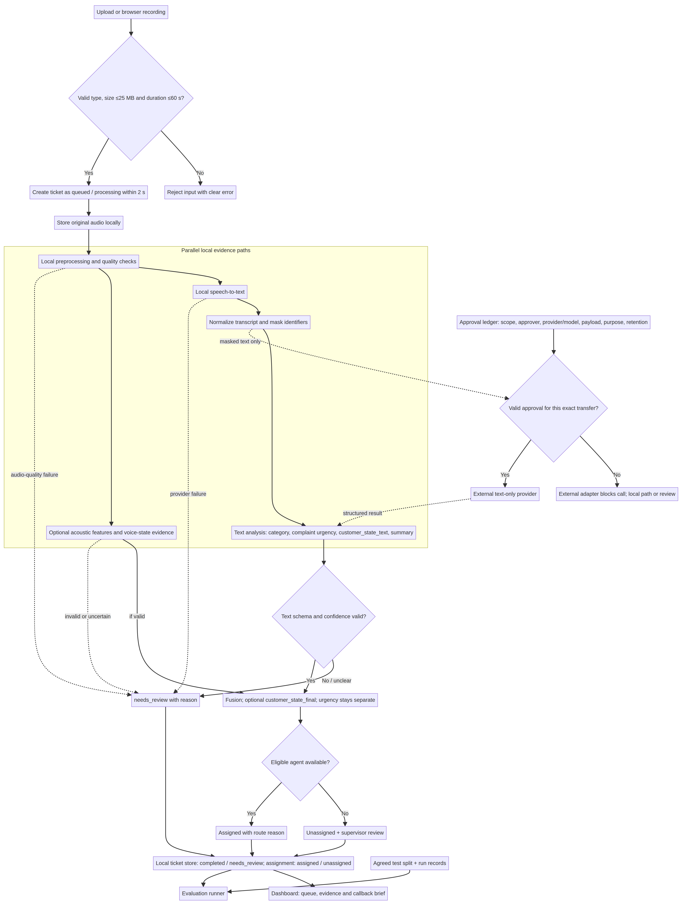

# Smart Voicemail Router

## Architecture and Diagrams

**Document ID:** SVR-ARCH-02  
**Version:** 1.2  
**Status:** Draft for team review, with taxonomy, provider, and runtime choices pending data review  
**Updated:** 10 November 2026  
**Formal project kickoff:** 11 November 2026

> **Architecture position:** A local-first competition prototype with provider boundaries. On-premises delivery and production telecom readiness remain future work.

### Revision notes

Version 1.2 aligns the architecture with the PRD and pair workstreams. It keeps complaint category, complaint urgency, customer state, voice evidence, and queue priority separate. Raw voice stays local by default; external text processing requires prior approval.

---

## 1. Architecture at a glance

The system turns one single-speaker voicemail into a routed, explained callback ticket. Audio preprocessing, speech-to-text, text analysis, acoustic evidence, fusion, routing, persistence, and the dashboard are separate modules connected through explicit contracts.

**Design principles**

1. **Separate signals.** Complaint category, complaint urgency, customer state, voice evidence, churn risk (if retained), and queue priority are different fields.
2. **Privacy by default.** Keep raw voice local. Mask identifiers before any explicitly permitted external text processing. Transcript masking does not anonymize audio.
3. **Explain the decision.** Store evidence and show why the ticket received its priority and route.
4. **Surface failures for review.** Low confidence, unsupported labels, provider errors, or no eligible agent produce a review state or unassigned ticket.
5. **Measure each configuration.** Record dataset version, provider/model/config, machine, per-stage timing, metrics, and limitations.
6. **Defer commercial claims.** Provider interfaces allow future substitution. Enterprise security and on-premises deployment require separate implementation.

## 2. System architecture

The editable source is in [`architecture-overview.mmd`](architecture-overview.mmd). After a valid upload or browser recording, the system creates a visible queued ticket. The original audio stays local. Speech/text and acoustic analyses produce separate evidence; the system records ticket state, review outcome, and assignment. The dashboard reads ticket data, while evaluation reads the approved test split and run records. External text processing requires a valid, pre-approved transfer record, and the text adapter cannot transmit audio.

### 2.1 Processing stages

| Stage | Responsibility | Output / boundary |
|---|---|---|
| 1. Ingestion | Accept upload or browser recording; validate format, size, duration, and basic quality. | Accept WAV/MP3/M4A up to 25 MB and up to 60 seconds. Recommend 15 to 60 second clips, but do not impose a 15-second minimum without a data-backed decision. Reject invalid inputs clearly. |
| 2. Queue creation | Create a ticket/status record for a valid submission. | Show `queued/processing` in the queue within 2 seconds. Invalid submissions are rejected before ticket processing. |
| 3. Local storage | Keep original and working copy inside the approved local data boundary. | Local paths and retention metadata; do not upload raw voice to notebooks or services by default. |
| 4. Preprocessing | Normalize sample rate/channel as agreed, trim silence if safe, and measure clipping/noise/duration. | Clean audio plus quality metadata. Keep the original unchanged until retention rules allow deletion. |
| 5. Speech path | Run STT locally by default; record language mix and uncertainty. | Raw transcript remains local; normalized transcript is generated separately. |
| 6. Acoustic path | Calculate measurable features and, only if validated, a voice-state candidate. | Feature values and confidence/quality. Voice evidence is optional and not a definitive emotion. |
| 7. Text analysis | Normalize telecom terms and identifiers locally; analyze the transcript. | Summary, complaint category, complaint urgency, and `customer_state_text`; enum values are gated on EDA. |
| 8. Fusion and decision | Combine only agreed fields, compute queue priority, and select an eligible agent. | Ticket fields, evidence, route reason, or human-review/unassigned status. `customer_state_final` is optional and requires an approved policy. |
| 9. Persistence and events | Save tickets, agent data, assignments, processing events, transfer approvals, and audit history. | Local prototype database; processing status (`completed`/`needs_review`) and assignment status (`assigned`/`unassigned`) are inspectable. |
| 10. Dashboard | Display the queue, ticket evidence, route, and callback brief. | Dashboard renders ticket data. |
| 11. Evaluation | Run independently against the approved test split and recorded experiment/config. | Per-field metrics and per-stage timing; results do not depend on dashboard rendering. |

### 2.2 Privacy gate for external providers

The default architecture does not transmit raw voice outside the local workspace. The external-text path accepts masked text only; it is not an authorization path for cloud speech-to-text or any raw-audio transfer. A team may run an external text-provider experiment only after checking competition rules, data license/consent, provider retention/terms, purpose, and the exact payload. Approval must be recorded **before** the call in a durable transfer-approval record tied to that scope and payload. An experiment log written after a call is not an approval control.

Each approval record must capture at least: `permitted`, approval basis and scope, approver, approval timestamp, provider/model, purpose, exact payload class and payload/dataset reference or fingerprint, retention/terms check, and a unique transfer ID. Link the actual transfer event and result to that ID. The adapter must verify that the record is permitted, current, and matches the exact proposed transfer; otherwise, it blocks the call. Raw audio is explicitly outside the scope of this external-text adapter. Any future proposal for external audio processing requires a separate explicit decision and permission review; masking a transcript later cannot undo an audio transfer.

## 3. Processing flow and service boundaries

A valid upload or browser recording creates a `queued/processing` ticket visible within 2 seconds, before analysis begins. The pipeline runs local preprocessing, then parallel speech/text and acoustic paths. The application validates the text output against a versioned schema, computes an explainable decision, stores the result, and notifies the dashboard. Provider, schema, or quality failures go to `needs_review`; no eligible agent results in `unassigned` with a reason. A failed model call must not silently produce a normal ticket: retry according to the provider contract, then mark the affected output for review. A successful ticket becomes `completed`; an unassigned ticket can still be completed while retaining `assignment_status=unassigned`. Cached output may be used only for the exact preapproved demo file and must be visibly identified as cached.

Evaluation runs against the agreed test split and reads approved reference labels, ticket outputs, and experiment records.

Conceptual endpoints for the prototype:

| Method | Endpoint | Purpose |
|---|---|---|
| `POST` | `/api/voicemails` | Submit an upload or browser recording and receive `202 Accepted` plus a ticket identifier/status; valid input must appear as `queued/processing` within 2 seconds. |
| `GET` | `/api/tickets/{id}` | Retrieve ticket fields, evidence, timing, status, and routing reason. |
| `GET` | `/api/agents` | Retrieve seeded demo agents and availability/skill fields. |
| `PATCH` | `/api/tickets/{id}` | Optional manual status/reassignment action with an audit event. |
| WebSocket | `/ws/queue` | Stream queue/status updates for the live dashboard. |

These are interface proposals. Pairs may start fixture-first scaffolding, provider adapters, EDA, and isolated unit tests before the final contract is frozen; agree stable production field/null/error behavior before integration. Keep fusion and routing in deterministic, separately testable business logic that does not depend on vendor-specific prompts.

## 4. Output semantics and contracts

The system-level ticket must preserve these separate concepts:

| Field | Meaning | Source | Contract status |
|---|---|---|---|
| `complaint_category` | Type of issue. | Text analysis, later checked against the data dictionary. | Candidate list only; final labels after EDA. |
| `complaint_urgency` | Time sensitivity/impact of the complaint. | Agreed complaint evidence and policy. | Class set and thresholds pending. |
| `customer_state_text` | Customer state inferred from words. | Text analyzer. | Class set pending. |
| `voice_state_candidate` | Optional state estimate from voice. | Validated acoustic/voice model, if any. | Not a truth label; optional until validated. |
| `customer_state_final` | Optional fused state, if a supported fusion policy is agreed. | Text and voice evidence. | Do not enable until rules and labels are agreed. |
| `churn_risk` | Possible customer departure risk. | Text/customer request and approved policy. | Retain only if EDA and annotation can support it. |
| `priority_score` | Queue ordering value. | Approved urgency, other approved signals, and wait time. | Formula/weights to be calibrated and versioned. |
| `route_reason` | Plain-language explanation of assignment or unassigned status. | Routing engine. | Required for every decision. |

A provisional text-analysis object may use stable field names while leaving allowed values open until EDA. The field schema must reject labels outside the team-approved enum and set a review flag for unclear or unsupported content. The voice path must return separate features/confidence and must never overwrite complaint urgency. Voice-state evidence may be absent without blocking a valid complaint-urgency result.

## 5. Data model

The following is a conceptual local prototype schema, not a migration script. Add a `schema_version` and `label_version` so that model outputs remain interpretable when taxonomy changes.

| Entity | Key fields | Notes |
|---|---|---|
| `voicemails` | `id`, local `audio_path`, `clean_path`, `duration_s`, `format`, `received_at`, `source`, `retention_until`, `processing_status` | Avoid public/object-storage URLs. Keep audio access inside the approved workspace. |
| `transcripts` | `voicemail_id`, `transcript_raw_local`, `transcript_normalized`, `language_mix`, `stt_provider`, `model_version`, `confidence`, `created_at` | Keep raw transcript local and access-restricted; store only as long as approved. Never send raw voice just because a text transcript is masked. |
| `analyses` | `voicemail_id`, `summary`, `complaint_category`, `complaint_urgency`, `customer_state_text`, optional `churn_risk`, `keywords`, `customer_request`, `suggested_script`, `confidence`, `needs_human_review`, `label_version` | Labels are constrained by the agreed taxonomy. Unknown values remain unknown/review. |
| `voice_evidence` | `voicemail_id`, `quality_features`, `acoustic_features`, optional `voice_state_candidate`, `arousal_or_score`, `confidence`, `model_version` | Optional voice model result is evidence with uncertainty, not definitive ground truth. |
| `tickets` | `id`, `voicemail_id`, `priority_score`, optional `customer_state_final`, `assigned_agent_id`, `assignment_status`, `route_reason`, `ticket_status`, `processing_ms`, `schema_version` | Ticket state is queued/processing/completed/needs_review; assignment can be assigned/unassigned. |
| `agents` | `id`, `name`, approved `skills`, `tier` if needed, `capacity`, `current_load`, `on_shift`, `languages` | Skill-to-category mapping and tier policy must be agreed before routing claims. |
| `ticket_events` | `id`, `ticket_id`, `event`, `detail`, `actor`, `created_at` | Audit model output, assignment, override, status changes, and linked transfer events. Do not log secrets or raw audio. |
| `external_transfer_approvals` | `transfer_id`, `permitted`, approval basis/scope, approver, timestamp, provider/model, purpose, payload class/reference or fingerprint, retention/terms check, linked transfer event | Must exist and match the exact proposed external text transfer before the adapter can run. It does not authorize raw-audio transfer. |
| `experiments` | `run_id`, dataset/version/split, provider/model/config, changed factor, metrics, machine, timestamps, artifact paths, optional `transfer_id` | Supports reproducibility and later ablation analysis; it is not a substitute for pre-transfer approval. |

SQLite remains a candidate for a low-friction local demo. Choose storage and retention implementation only after the dataset access and local-machine workflow are known. Production-grade encryption, access control, retention enforcement, and scale are not claimed by a prototype schema.

## 6. Fusion, priority, and routing

### 6.1 Fusion rules

Do not reproduce the old matrix that mixed customer emotion and complaint urgency. First agree field definitions and labels using the dataset. Then define a versioned, testable rule set for how text and validated voice evidence contribute to any final customer-state estimate. Keep `complaint_urgency` separate from customer-state fusion. Missing/low-quality voice evidence should not lower complaint urgency or force a customer-state label. If the text output is unclear or invalid, mark it for review; do not substitute a voice label for a missing complaint-urgency value.

### 6.2 Queue priority

A deterministic baseline can combine approved complaint urgency, any separately approved churn-risk signal, validated acoustic evidence if appropriate, explicit high-impact keywords, and waiting time. Exact weights, normalization, thresholds, and tie-breaking remain open until EDA and policy agreement. Every score should store its rule/config version and evidence. Queue ordering should have deterministic tie-breakers, such as oldest received first.

### 6.3 Agent matching

Proposed hard eligibility checks: on shift/available, capacity remains, language fit, and any policy-required skill. Proposed match preferences: best fit to complaint category/skill, then relevant experience/tier if the team defines one, then capacity/load and a deterministic tie-breaker. These are design candidates, not frozen business rules.

If no agent meets the hard filters, leave the ticket unassigned, state why, and send it to supervisor review. Do not silently drop hard filters to force an assignment. Reassignment/override must record the actor, previous assignment, new assignment, and reason.

## 7. Provider and environment strategy

### Provider interfaces

Keep interfaces for speech-to-text, text analysis, acoustic/voice analysis, and storage. Local implementations are the default path where practical. The external text adapter must reject every call unless it has a valid, matching pre-transfer approval record; it accepts masked text only and cannot transmit raw audio. Other external providers are not enabled by this approval record. Implementation details and model names are not locked in this revision. Check current model cards, licenses, APIs, and quotas at implementation time rather than hard-coding names into business logic.

No model is assumed to be language-independent or accurate on Egyptian Arabic phone audio. Compare candidates on the team's own approved data and report the limits.

### CPU, GPU, and Colab

| Environment | Intended role | Guardrails |
|---|---|---|
| CPU local | Required reproducible baseline for core tests and a declared local run path; lightweight preprocessing and any model that meets the performance need. | Core tests must not require CUDA. Record CPU/memory and actual latency. |
| GPU local | Optional acceleration for selected local inference experiments. | Add GPU-specific libraries only when the selected model needs them; isolate CUDA/PyTorch dependencies from the CPU baseline. Record GPU and runtime versions. |
| Google Colab/free cloud plan | Optional disposable experiment environment when data rules permit. | It is not the source of truth; sync source/results through the later repository process. Do not upload private voice data or secrets unless explicitly permitted. Free resources and runtime availability are not guaranteed. |

Separate CPU/GPU dependency sets and environment READMEs belong to the later repository setup phase; no requirements files or environments are created in this document revision. The exact PyTorch/CUDA versions must wait until a model and target GPU are chosen.

### UI and packaging

The final demo needs a browser dashboard. Frontend and deployment ownership remain open at kickoff. After the pair-owned core produces its first integrated fixture run, Hazem will name the implementer(s) before demo-readiness; his own implementation role remains open. Until then, pairs should keep contracts stable and test with mocks so UI or packaging decisions do not block signal, fusion, routing, or evaluation work. Docker and production packaging are outside the current architecture scope.

## 8. Module responsibilities and pair interfaces

| Pair workstream | Owns the first implementation of | Provides to the next stage |
|---|---|---|
| Hazem & Ibthal: Audio and speech evidence | Local audio validation/preprocessing, STT adapter/benchmark, transcript quality/language-mix metadata, acoustic features, optional voice-state candidate. | `AudioAnalysis`: local audio references, transcript + confidence/language metadata, audio-quality/acoustic evidence; no final queue decision. |
| Lama & Ahmed: Complaint and customer understanding | Transcript normalization/glossary/identifier masking, structured text analysis, summary, complaint category/urgency/customer-state fields, customer request/script, label agreement after EDA. | Versioned `TextAnalysis` object with approved labels and review/confidence fields. |
| Sira & Aya: Decision, routing, and evaluation | Versioned fusion/priority/routing rules, agent/skill data model, no-match behavior, pure tests, evaluation/integration runner, run records. | `TriageDecision`: priority, assignment/unassigned state, reason, contributing evidence/rule version and evaluation results. |

All three pairs run the same initial EDA before any pair freezes model classes. They use one dataset snapshot and shared schemas. UI and deployment owners remain unassigned until the team assesses the core work.

## 9. Technology decisions and open points

| Layer | Current working direction | Must be validated before locking |
|---|---|---|
| Language | Python is the working assumption for AI/audio/backend code. | Python version supported by selected libraries and team PCs. |
| API | FastAPI/Pydantic are reasonable candidates. | Need for async tasks/WebSocket and final interface contracts. |
| Database | Local SQLite candidate for a demo. | Retention, file path safety, concurrency and later migration needs. |
| Audio | ffmpeg plus Python audio libraries are candidates. | License/installation, supported formats, audio quality and CPU/GPU needs. |
| STT | Local-first provider adapter; candidate comparison after EDA. | Egyptian Arabic/code-switching accuracy, rights, latency, hardware and competition rules. |
| Text model | Local or explicitly approved external model behind an interface. | Data-transfer permission, structured-output reliability, cost/quota, latency and language performance. |
| Voice model | Acoustic features first; pretrained voice-state model only if evidence supports it. | License, label fit, phone-quality performance, bias and confidence calibration. |
| Dashboard | A projector-readable browser dashboard is required for the final demo. | Stack and detailed owner are deferred; English UI with Arabic content is a working possibility, not a final language decision. |
| Packaging | Reproducible local run instructions are needed. | Full deployment owner and Docker/hosting are deferred until core proof. |

## 10. Future commercial path: on-premises

An operator deployment inside its own infrastructure belongs to a future product stage, after the competition prototype demonstrates value and privacy/security requirements are understood. Changing a configuration value alone will not deliver it. A commercial on-premises version would require full local providers, deployment/runtime packaging, access control, secrets management, audit/retention controls, monitoring, backup/recovery, installation testing, and operator-specific integration/security review. The competition prototype should keep provider boundaries clean and describe these capabilities as future work.

## 11. Failure and fallback behavior

| Condition | Required behavior |
|---|---|
| Invalid type, size, or duration | Reject with a clear message before analysis; do not mark a ticket completed. |
| Audio quality too poor | Preserve the valid submission, mark the relevant output uncertain, and request human review. |
| STT/text/voice provider error | Record stage and timing/error; retry according to the provider contract; then leave the affected output incomplete/needs review. |
| Unknown label or invalid JSON | Reject the output; one controlled retry may be used if approved; otherwise needs review. |
| No eligible agent | Keep the ticket unassigned and explain the missing eligibility condition. |
| Missing, expired, or mismatched external-transfer approval | Block the external text call before sending any payload; continue locally or mark the affected result for review. |
| External provider prohibited or unavailable | Continue the local path or fail visibly to review; never silently transmit raw audio. |
| Demo cache hit | Use only a result tied to the exact approved demo clip; identify it as cached. |

## Appendix A. Architecture constraints carried into repository setup

- No repository, branches, requirements folders, or deployment configuration are created as part of this document revision.
- When the repository phase is authorized, define separate CPU and GPU dependency paths and optional Colab instructions; do not make CUDA a baseline requirement.
- Keep data access rules, label/schema version, experiment records, and interface tests close to the code so all three pairs can work without guessing.
