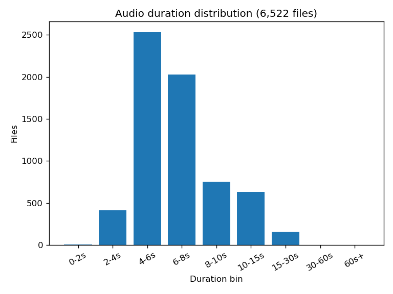
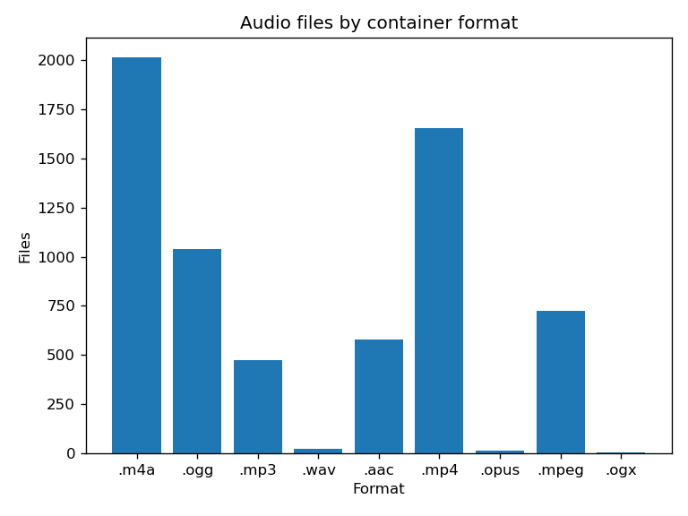
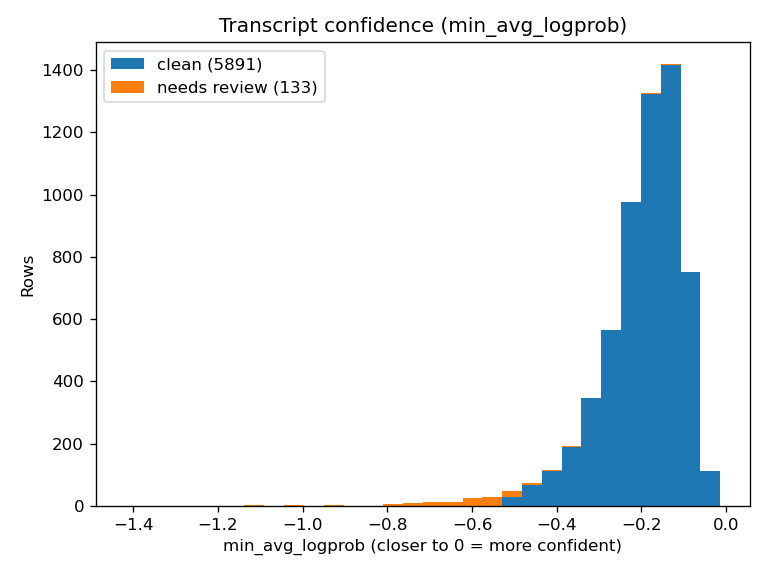
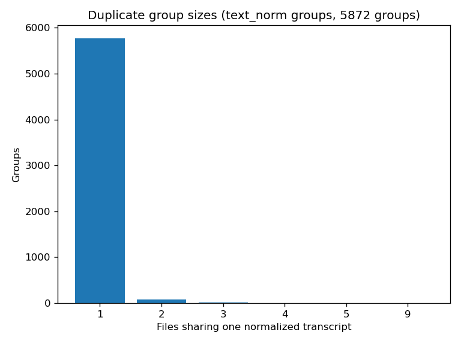

# EDA: Audio and Speech Evidence, Hazem & Ebtihal pair (Phase 1)

**Project:** Smart Voicemail Router
**Pair:** Hazem & Ebtihal, audio and speech evidence
**Branch:** `team/audio-speech`
**Date:** 2026-11-10
**Status:** Phase 1 pair EDA note, for the weekly team comparison. No labels are finalized here; no model was trained.
**Contact for questions:** Hazem Elerefy, hazemelerefy@gmail.com

All numbers below were recomputed by the scripts in `eda/` from the dataset snapshot and the four analysis CSVs. Nothing was copied from memory or from earlier summaries. Aggregate statistics only: this note contains no transcript text, no phone numbers, no names, and no audio.

---

## 1. Origin

The dataset snapshot is the Drive folder "AI Voicemail", file `الكل ان شاء الله.rar`:

- Archive size: 735,052,270 bytes
- SHA256: `3518fdd5edad615bf81fc25657f84c0ae476e41f9b31e09c8ea31995f9284e63`
- Local copy: `~/workspace/ai-customer-support/dataset/dataset.rar`
- Extracted to: `~/workspace/ai-customer-support/dataset/extracted/` (outside the repo)
- Archive contents: exactly 6,522 audio files, no CSVs or other files inside

The snapshot was provided by the project owner. What is **not** settled: dataset license, speaker consent, competition permission, retention period, and allowed processing locations. Those determinations are still open (see the README data boundary and team-allocation §3 item 1) and must be confirmed by the team before Phase 2 uses the data beyond this local EDA. No external-provider experiment was run; all processing in this note was local.

Analysis inputs (read-only, never copied into the repo):

- `transcripts_flagged_14_4zfb.csv`, 6,024 rows, STT output for the kept files
- `inventory_clean_13_825a.csv`, 6,522 rows, per-file inventory and acoustic measures
- `stt_results_12_d6z5.csv`, 20-row model evaluation
- `sample_11_laqj.csv`, 20-row reference sample

---

## 2. Inventory

Every extracted file was probed individually with ffprobe (format, codec, duration, sample rate, channels). Zero files were unreadable.

| Measure | Value |
|---|---|
| Total files | 6,522 |
| Total duration | 12.63 hours |
| Duration mean / median | 6.972 s / 6.208 s |
| Duration min / max | 0.41 s / 125.922 s |
| Duration p10 / p90 | 4.304 s / 10.611 s |
| Unreadable files | 0 |

Formats (by container extension): m4a 2,012; mp4 1,656; ogg 1,039; mpeg 723; aac 579; mp3 472; wav 23; opus 13; ogx 5. Audio codecs: aac 4,165; mp3 1,177; opus 1,157; pcm_s24le 23. Sample rates: 48,000 Hz on 5,470 files, 44,100 Hz on 1,052 files. Channels: mono 3,709 files, stereo 2,813 files.





Duration histogram (files per bin): 0-2 s: 4; 2-4 s: 415; 4-6 s: 2,532; 6-8 s: 2,028; 8-10 s: 752; 10-15 s: 633; 15-30 s: 157; 30-60 s: 0; 60 s+: 1. The single file over 60 seconds (125.922 s) is the one the inventory excludes as too long.

Clipping and noise (aggregates recomputed from the per-file measures in `inventory_clean_13_825a.csv`; these measures were taken as given, not re-measured by ffprobe):

| Measure | Value |
|---|---|
| RMS level mean / median | -22.67 dB / -22.3 dB |
| Peak, maximum | 1.0 (full scale reached on at least one file) |
| Files with any clipping (clip_pct > 0) | 338 of 6,522 (320 of the 6,024 kept) |
| Maximum clip_pct | 1.208% |
| Silence mean / median | 16.49% / 15.9% |
| Files with silence over 50% | 18 |
| SNR mean / median / min | 35.53 dB / 34.3 dB / 7.3 dB |
| Files with SNR under 10 dB | 22 |

Kept files (6,024) total 11.685 hours. The inventory exclusion breakdown reconciles exactly with the transcript set: duplicate 470, low SNR 18, clipped 6, too short 2, too long 1, mostly silence 1, 498 excluded in total, and the file-id overlap between the inventory and the transcripts is exactly 6,024, with 0 transcript-only files.

---

## 3. Language

Transcripts are overwhelmingly Egyptian Arabic. Language mix was counted from the transcript text:

- Rows containing Latin-script tokens: 41 of 6,024 (0.68%)
- Rows in pure Arabic script: 5,983
- Most frequent Latin tokens (counts only): otp 6, g 5, call 4, me 4, back 4, application 3, vpn 3, control 2, flex 2, online 2, logout 2, only 2

Code-switching is therefore rare and concentrated in short English telecom terms (one-time-password and app words). There is no separate English-only subset to model.

Text length: mean 15.82 words per transcript (median 14, min 2, max 72, p10 10, p90 24); mean 81.23 characters. Normalized text (`text_norm`) is nearly identical in length (mean 15.82 words, 80.64 characters), so normalization unifies letter forms and strips punctuation without changing word counts materially. The shortest transcripts (2 words) overlap with the `too_short` review flags.

Dialect note: the reference texts in the 20-row evaluation are written in Egyptian dialect while Whisper output tends toward Modern Standard Arabic spelling, so the WER numbers in §4 are dialect-inflated and should not be read as pure recognition error.

---

## 4. Transcript and STT quality

STT output format v1 is locked (10 columns: file, model, text, text_norm, min_avg_logprob, max_no_speech_prob, needs_review, review_reasons, dup_text_size, error). The transcripts file carries those 10 columns plus the `prompt` column, which format v1 drops. The prompt column holds the value `none` on 5,443 rows and is empty on 581 rows; it carries no information either way.

| Measure | Value |
|---|---|
| Transcript rows | 6,024 |
| Model | whisper-large-v3 only (6,024 rows) |
| Needs review | 133 (2.2%) |
| Clean | 5,891 |
| Empty transcripts | 0 |
| Error values | 0 |
| needs_review without a reason | 0 |
| review_reasons without the flag | 0 |

Review-reason token counts (a row can carry more than one): low_confidence 121, hallucination_suspect 15, too_short 10, prompt_leak 3, repetition 2. The most common single combination is low_confidence alone (106 rows).

Confidence separates clean from flagged rows clearly. `min_avg_logprob` (closer to 0 is more confident): overall mean -0.202, median -0.179; flagged mean -0.628, clean mean -0.192; overall p10 -0.328, p90 -0.096. `max_no_speech_prob`: overall mean 0.007, max 0.248; flagged mean 0.016.



Model comparison on the 20-row evaluation file: whisper-large-v3 mean WER 0.291, whisper-large-v3-turbo mean WER 0.3495; mean runtime per clip 2.251 s (large-v3) vs 2.479 s (turbo). Large-v3 wins on both accuracy and speed on this sample, but the sample is only 20 rows and the WER is dialect-inflated (see §3), so this is a directional result, not a selection proof.

**Known defect, verified (not silently fixed):** `dup_text_size` is wrong on exactly 3 rows. In each case the stored value is 1 while an independent recount grouped by `text_norm` gives 3. The three files are `الكل ان شاء الله\1015.m4a`, `الكل ان شاء الله\WhatsApp Audio 2025-11-30 at 11.54.59 PM (1).mp4`, and `الكل ان شاء الله\AUDIO-2025-11-27-17-01-39.m4a`. All three share one repeated hallucinated phrase. The format stays locked; the fix belongs in the pipeline (recompute `dup_text_size` from `text_norm` at write time), and Ebtihal co-owns the format, so the correction needs her confirmation before the value is treated as fixed.

---

## 5. Duplicates

Exact duplicates were counted by grouping transcripts on `text_norm` (group sizes only, no transcript text):

- Distinct normalized transcripts: 5,872 groups
- Groups with more than one file: 108 (260 rows)
- Largest group: 9 files sharing one normalized transcript
- Group-size distribution (groups): size 1: 5,764; size 2: 79; size 3: 20; size 4: 7; size 5: 1; size 9: 1
- Duplicate groups spanning more than one container format: 84



Audio-level exact-duplicate check by (file size, probed duration) collisions found 418 collision groups covering 953 files. That proxy over-counts: the inventory's content-based duplicate flag marks 470 files, and files can share a size and a rounded duration without being the same recording. Do not use the (size, duration) proxy for dedup decisions in Phase 2; use content hashes (the inventory already carries an md5 per file).

The duplicate structure matters for splitting: 260 rows sit in duplicate groups, and 84 groups cross container formats, so a naive random split would leak near-identical audio across train and evaluation. The split in §8 keeps whole groups on one side.

---

## 6. Labels

There are no labels in this dataset. `category` is empty on all 20 rows of the sample file and all 20 rows of the evaluation file, and `sentiment` is empty on the same rows. The transcripts and inventory files do not carry label columns at all.

Per the PRD, the fields that must stay distinct are complaint category, complaint urgency, customer state, and queue priority. None of these is defined yet, and this EDA finalizes none of them.

**Annotation protocol proposal (for team approval, not a decision):**

1. Double annotation: two annotators label each kept transcript independently; disagreements go to adjudication by a third reviewer, and the adjudicated value is the label.
2. Egyptian-dialect glossary first: agree the spelling variants and the English telecom terms before labeling, so the same complaint is not split across spellings.
3. Separate fields, separate passes: category, urgency, and customer state are labeled as independent fields; queue priority is a system decision, not an annotation target.
4. Review queue first: the 133 flagged transcripts are annotated only after a human confirms or corrects their transcripts; a corrected transcript replaces the STT text and the row leaves the review queue.
5. Calibration set: label a shared 100-row calibration batch first, measure agreement, and only then scale to the full set. If agreement is low, revise the guide instead of labeling on.

---

## 7. Privacy

Pattern counts only, over transcript text and normalized text (6,024 rows scanned). No matched strings were stored and no examples are given here:

| Pattern | Rows |
|---|---|
| Egyptian mobile pattern | 0 |
| International (+20) phone pattern | 0 |
| Email pattern | 0 |
| Digit runs of 10 or more | 0 |

No phone numbers or email addresses appear in the transcripts by these patterns. Person names cannot be detected reliably from transcripts alone (no name list; dialect spellings vary), so no name count is attempted or claimed.

Data boundary: raw recordings stay local. A transcript approval does not authorize audio transfer, and no external-provider experiment was run or is approved. Any future external text experiment needs prior, durable approval for the exact provider, purpose, and payload, with local identifier masking first.

---

## 8. Split

Proposed 80/10/10 split over the 6,024 transcribed rows: train 4,820, dev 602, test 602. Method: whole `text_norm` groups were kept on one side (greedy assignment ordered by duration-quartile and format stratum, each group going to the split with the largest relative shortfall). Duration quartiles of the transcribed rows (probed durations): Q1 5.12 s, Q2 6.223 s, Q3 7.874 s.

- Duplicate groups leaking across sides: **0**
- Per-split flagged rows: train 109, dev 10, test 14
- Per-split mean duration: train 7.003 s, dev 6.900 s, test 6.917 s
- Per-split formats stay close to the overall mix in each split

The per-file assignment is saved outside the repo at `~/workspace/ai-customer-support/dataset/split_assignment.json` for Phase 2 reuse. Limitation: there are no speaker IDs in the data, so this split is text-group-aware and duration/format-stratified, but **not** speaker-aware. If speaker identity can be established later, the split must be re-checked for same-speaker leakage before it is frozen.

---

## 9. Reproducibility

Dataset checksum: SHA256 `3518fdd5edad615bf81fc25657f84c0ae476e41f9b31e09c8ea31995f9284e63` for `dataset.rar` (735,052,270 bytes). Extraction and all analysis ran locally on Ubuntu 24.04, Python 3.12.3, pandas 2.1.4, matplotlib 3.6.3, pytest 9.2.0, ffprobe 8.1.2, unrar 7.00. The pytest venv lives at `~/workspace/ai-customer-support/.venv-eda/` (system-site-packages; nothing was installed into system Python).

Commands (run from the repo root on branch `team/audio-speech`):

```sh
mkdir -p ~/workspace/ai-customer-support/dataset/extracted
cd ~/workspace/ai-customer-support/dataset/extracted
sha256sum ../dataset.rar
LC_ALL=C.UTF-8 unrar x ../dataset.rar
cd ~/workspace/ai-customer-support/smart-voicemail-router
/home/hatch/workspace/ai-customer-support/.venv-eda/bin/python eda/audio_inventory.py --workers 8
/home/hatch/workspace/ai-customer-support/.venv-eda/bin/python eda/transcript_quality.py
/home/hatch/workspace/ai-customer-support/.venv-eda/bin/python eda/duplicates_labels.py
/home/hatch/workspace/ai-customer-support/.venv-eda/bin/python eda/privacy_split.py
/home/hatch/workspace/ai-customer-support/.venv-eda/bin/python -m pytest eda/test_eda.py -v
```

Artifacts: `eda/eda_summary.json` (all recomputed numbers), `eda/figures/` (4 charts), `eda/test_eda.py` (12 checks, all passing). Per-file audio metadata lives outside the repo at `~/workspace/ai-customer-support/dataset/audio_inventory.json`; the split assignment at `~/workspace/ai-customer-support/dataset/split_assignment.json`. No audio, CSV, transcript, or archive file is tracked by git.

## 10. Assumptions, limitations, and next decisions

Assumptions and limitations:

- The snapshot as provided is the authorized dataset version; rights, consent, retention, and processing locations are still unconfirmed (see §1).
- Clip, silence, RMS, and SNR aggregates come from the per-file measures in `inventory_clean_13_825a.csv`, taken as given; ffprobe independently verified counts, formats, durations, sample rates, and channels, but not those acoustic measures.
- WER is measured on 20 rows only and is dialect-inflated; it supports a direction, not a model selection.
- The `prompt` column is empty on 581 rows, so "always none" is not accurate for this file.
- The (size, duration) duplicate proxy over-counts and was not used for any decision.
- The split is not speaker-aware; no speaker IDs exist in the data.
- CSV file ids use backslashes while extracted paths use forward slashes; scripts normalize before joining.
- One earlier probe run printed totals but its output files were not on disk when checked; the probe was re-run identically with a log file and the artifacts were verified by test. Cause unknown, recorded in the work ledger.

Recommended next decisions for the team meeting:

1. Confirm dataset rights, consent, retention, and processing locations so Phase 2 has a settled boundary.
2. Approve this split (or request changes) and freeze it before preprocessing.
3. Confirm STT format v1 stays locked and agree the pipeline fix for the 3 wrong `dup_text_size` values, with Ebtihal.
4. Approve the annotation protocol in §6 and the calibration batch before any labeling starts.
5. Decide Phase 2 preprocessing scope: dedup by content hash (not size/duration), disposition of the 498 excluded files, and the human review queue for the 133 flagged transcripts.
