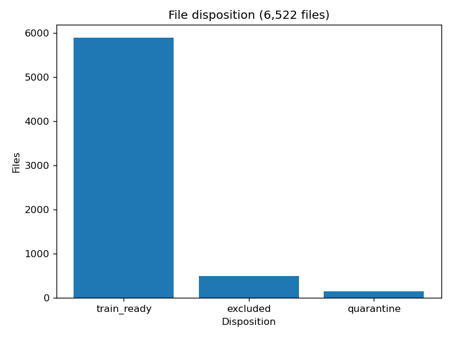

# Preprocessing: Audio and Speech Evidence, Hazem & Ebtihal pair (Phase 2)

Executed notebook: `preprocessing/preprocessing_audio_speech.ipynb`.

Training-ready set built from the EDA-verified dataset snapshot. Every
disposition is recorded; nothing was silently altered; the canonical
files are byte-identical before and after.

## 1. Inputs

- Dataset snapshot: Drive RAR `svr-voicemail-corpus.rar`, 735,052,270 bytes,
  SHA256 `3518fdd5edad615bf81fc25657f84c0ae476e41f9b31e09c8ea31995f9284e63`,
  extracted at `~/workspace/ai-customer-support/dataset/extracted/`
  (6,522 files, verified before starting).
- Canonical transcripts: `transcripts_flagged_14_4zfb.csv` (6,024 rows).
- Canonical inventory: `inventory_clean_13_825a.csv` (6,522 rows).
- EDA summary + split assignment (Phase 1), used as reference only.
- Locked STT output format v1 (10 columns). The derived cleaned file
  carries all 11 columns of the canonical file (the 10 locked v1
  columns + `prompt`, which the canonical CSV retains) plus exactly
  two preprocessing-only columns, `prep_status` and `prep_reason`,
  and is NOT the canonical STT output.

Canonical file hashes (recorded before the run in
`dataset/preprocessed/run_log_hashes.txt`, re-verified after, unchanged):

| file | SHA256 |
|---|---|
| transcripts_flagged_14_4zfb.csv | 5868ef24976933cbcae773a8d8e922ee1747eb98406efc96833df6b9e9fed232 |
| inventory_clean_13_825a.csv | 7e3002204043a80d5684de6f6df7f862e55b2e753471cb54d631038e274fd8db |
| stt_results_12_d6z5.csv | 833637ea734b5466f4ad4fcfde779cb694e32883a1f2eee7e881fb887eef4607 |
| sample_11_laqj.csv | 282a7956524b9968bc6d64a863330b767756053ee9ff295d3e72576819773e14 |

## 2. Fixed decisions (from the plan)

- Audio standard for training: 16 kHz mono WAV (Whisper input
  standard). Only train-ready files are standardized. Loudness is NOT
  changed; levels are recorded as measured.
- Blocking quarantine reasons: `needs_review` flag, >50% silence,
  SNR < 10 dB, duplicate audio content (decoded-PCM SHA256 match).
  Clipping is a NON-blocking flag recorded in `prep_reason`.
- Dedup by decoded-audio content hash (SHA256 of ffmpeg-decoded 16 kHz
  mono PCM), never by (size, duration). First occurrence kept.
- Prompt normalization: empty prompt (581 rows) → `none` in the
  derived file, documented.
- The 498 excluded files stay excluded. Recoverable ones are counted,
  none re-included.
- Split recomputed on the train-ready set (seed 42, 70/20/10, whole
  `text_norm` groups on one side, 0 leaks). The EDA split (4217/1205/602
  on all 6,024 rows) is superseded for the training pool.

## 3. Disposition

6,522 files reconcile exactly: train-ready 5,881 + quarantine 143 +
excluded 498. 6,024 transcripts reconcile exactly: train-ready 5,881 +
quarantine 143.



| status | files | reason breakdown |
|---|---|---|
| train_ready | 5,881 | includes 312 clipping-flagged (non-blocking) |
| quarantine | 143 | needs_review 133, silence >50% 10, SNR <10 dB 0 |
| excluded | 498 | duplicate 470, low_snr 18, clipped 6, too_short 2, too_long 1, mostly_silence 1 |

Quarantine reason overlaps: none between needs_review and silence;
8 quarantined rows also carry the clipping flag (5 needs_review +
clipping, 3 silence + clipping). SNR < 10 dB contributes 0 rows to the
quarantine: every SNR < 10 dB file is already among the 498 excluded.

## 4. Transcript cleaning (derived file only)

- `dup_text_size` recomputed from `text_norm` group sizes in the
  derived file. Exactly 3 rows changed (stored 1, actual 3). The fix
  is proposed, pending Ebtihal's confirmation as co-owner of STT
  format v1. The canonical file is untouched.
- Prompt normalized: 581 empty prompts → `none`; all 6,024 rows now
  read `none`.
- Derived file: `dataset/preprocessed/transcripts_clean.csv` (11
  canonical columns + `prep_status` + `prep_reason`), outside the repo.
- Per-file disposition manifest (file IDs + status + reason codes, no
  transcript text): `dataset/preprocessed/disposition_manifest.csv`,
  6,522 rows, outside the repo.

## 5. Audio standardization and dedup

- 5,881 train-ready files standardized to 16 kHz mono WAV:
  `dataset/preprocessed/audio_16k/*.wav` (total 41,093.33 s = 11.41 h).
  Every WAV verified: 16 kHz, mono, frame count and PCM hash equal
  the decoded record (`dataset/preprocessed/audio_decode.json`).
- Dedup result: 0 duplicate audio contents found. Cross-checks: 0
  train-ready files share a file md5, and all 470 inventory
  `is_duplicate` files are among the 498 excluded. The 752 files
  sharing (size_kb, duration_s) confirm why that proxy must not be
  used for dedup.
- Two pipeline incidents, both fixed and regression-tested:
  - 3 files (`Café Suprême` *) are NFC in the CSVs but NFD on disk
    (unrar extracted accented Latin names decomposed). Path
    resolution NFD-normalizes every path; the test
    `test_all_train_ready_sources_exist` guards it.
  - Inventory `duration_s` is ffprobe's estimate and is unreliable
    for raw ADTS .aac: decoded-vs-inventory drift > 0.1 s on 82
    files (79 .aac, 3 .m4a; max 0.487 s). Duration is therefore
    verified against the decoded PCM, and the drift is recorded
    here, not gated. EDA duration aggregates inherit the same
    estimation error on those files.

## 6. Split

Recomputed on the 5,881 train-ready files, seed 42, stratified by
duration quartile + format, whole `text_norm` groups on one side:

| split | files | share |
|---|---|---|
| train | 4,117 | 70.0% |
| val | 1,176 | 20.0% |
| test | 588 | 10.0% |

Leaked `text_norm` groups: 0. Files:
`dataset/preprocessed/split_train.json`, `split_val.json`,
`split_test.json` (outside the repo). The EDA split is superseded for
the training pool; the EDA assignment file is kept for reference only.

## 7. Excluded-file disposition

498 files, reasons from the inventory. Recoverable in principle = 26
(readable audio + a reason a defined operation could rescue):
low_snr 18 (denoise), clipped 6 (declip/tolerate, clip_pct 0.53-1.21%
vs kept max 0.497%), too_long 1 (125.92 s, chunkable),
mostly_silence 1 (64.6% silence of 13.29 s, trimmable). Permanently
unusable = 472: duplicate 470 (content already in the pool via the
kept copy) and too_short 2 (0.41 s, 0.73 s, no content to recover).
Re-include none without a team decision.

## 8. Open team items

- Adoption of the recomputed `dup_text_size` values as canonical →
  Ebtihal (co-owner of STT format v1).
- Freezing the recomputed split → team meeting.
- Rights, consent, retention, processing locations → team (still
  unconfirmed; preprocessing stays local-only).
- Annotation protocol + calibration batch → team meeting.
- Whether quarantined rows re-enter after human review → human review
  queue, not this phase.
- Whether the 26 recoverable excluded files are rescued → team decision.

## 9. Assumptions and limitations

- Acoustic measures (silence %, SNR, clipping) are taken from
  `inventory_clean.csv` as given (EDA §10); ffprobe independently
  verified counts, formats, durations, sample rates, and channels,
  but not those measures.
- Inventory `duration_s` is an ffprobe estimate; 82 files (mostly
  .aac) drift > 0.1 s from decoded duration (see §5). Split
  stratification used inventory durations; the 82 files cannot
  materially move quartile boundaries.
- The split is not speaker-aware: no speaker IDs exist. If speaker
  identity is established later, re-check for same-speaker leakage
  before freezing.
- Content-hash dedup catches bit-identical decoded PCM only. The same
  recording re-encoded through a different codec produces different
  PCM samples and would not be caught; no such case was found (0 file
  md5 collisions in the train-ready set).
- WER is dialect-inflated and 20 rows only; it supports a direction
  (large-v3 over turbo), not a model selection.

## 10. Reproducibility

Derived data lives outside the repo at
`~/workspace/ai-customer-support/dataset/preprocessed/` and is never
committed: `transcripts_clean.csv`, `disposition_manifest.csv`,
`audio_16k/*.wav`, `audio_decode.json`, `split_train.json`,
`split_val.json`, `split_test.json`, `excluded_disposition.json`,
`run_log_hashes.txt`. Repo holds scripts, tests, summary, and this note.

Commands (run from the repo root, branch `team/audio-speech`):

```bash
sha256sum ~/workspace/ai-customer-support/dataset/dataset.rar
sha256sum -c ~/workspace/ai-customer-support/dataset/preprocessed/run_log_hashes.txt
/home/hatch/workspace/ai-customer-support/.venv-eda/bin/python preprocessing/clean_transcripts.py
/home/hatch/workspace/ai-customer-support/.venv-eda/bin/python preprocessing/standardize_audio.py
/home/hatch/workspace/ai-customer-support/.venv-eda/bin/python preprocessing/split_and_exclusions.py
/home/hatch/workspace/ai-customer-support/.venv-eda/bin/python preprocessing/build_summary.py
/home/hatch/workspace/ai-customer-support/.venv-eda/bin/python -m pytest preprocessing/test_preprocessing.py -v
node ~/workspace/custom-skills/local-unlazy/scripts/gate-check.mjs --status preprocessing/GATES.md
```

Deterministic: re-running the pipeline on the same snapshot produces
byte-identical derived CSVs and identical manifest hashes (verified by
re-running the transcript and split steps and comparing SHA256).
Verification: 25/25 pytest tests pass; all 10 unlazy gates met (see
`preprocessing/GATES.md`).
